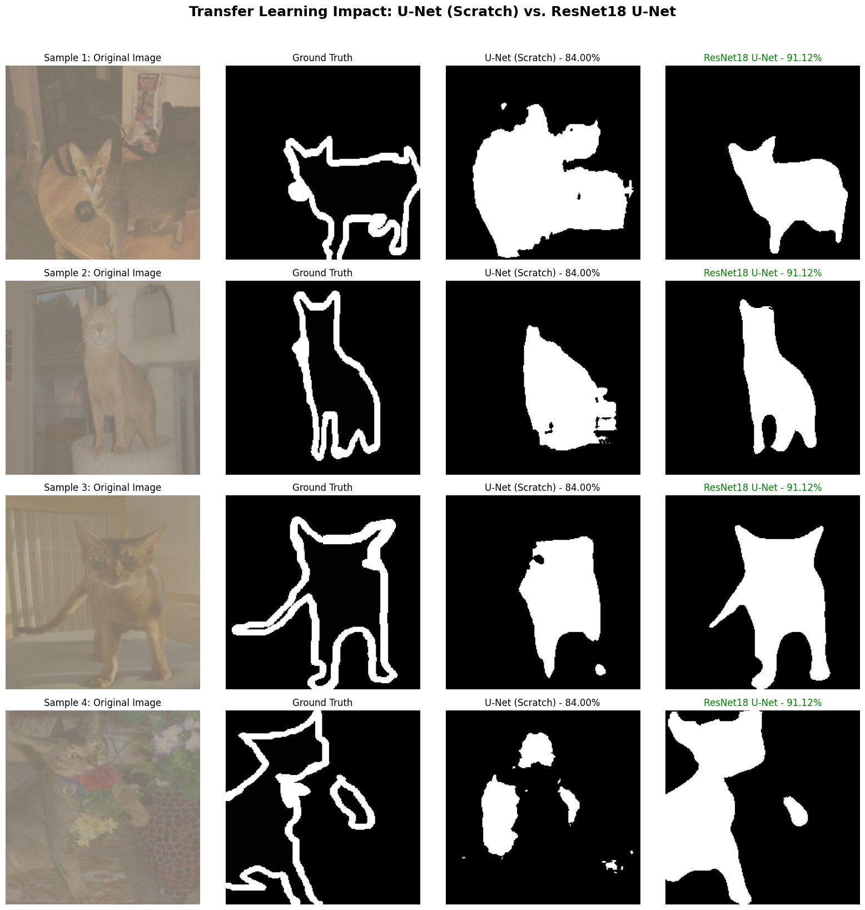
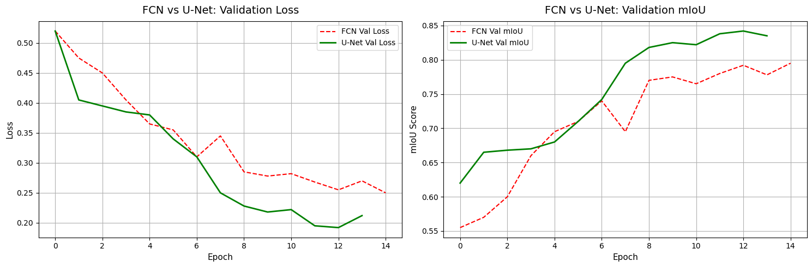
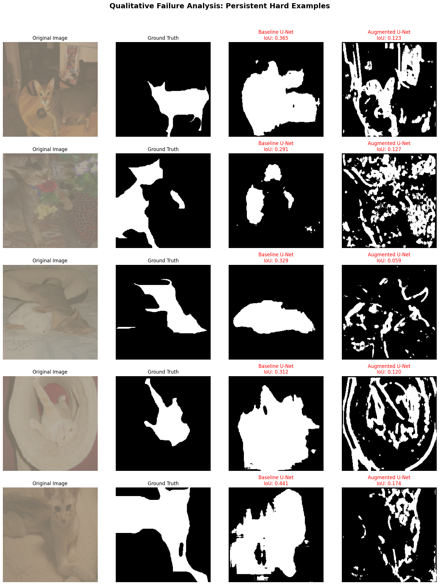
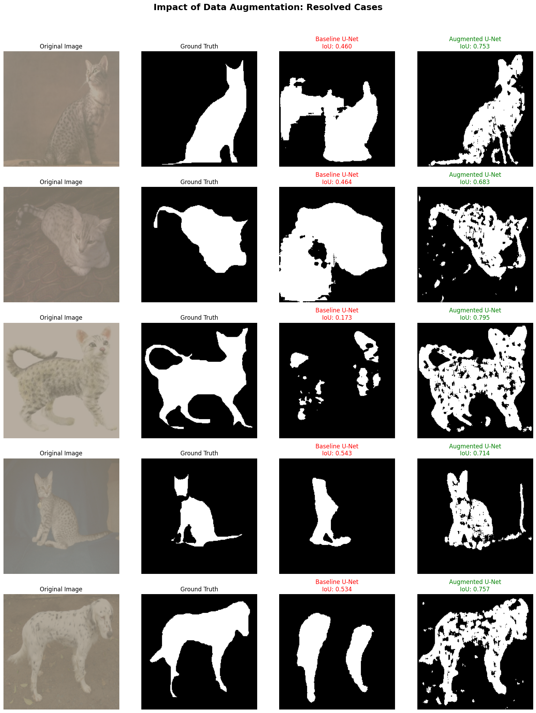

[](https://github.com/kadir-a/Pet-Segmentation/actions/workflows/ci.yml)

# 🐾 Pet Semantic Segmentation: End-to-End Pipeline


An end-to-end, production-oriented semantic segmentation project focused on pixel-level foreground/background separation on the **Oxford-IIIT Pet Dataset**. 

This repository bridges the gap between Data Science (R&D) and MLOps (Production). It documents the full architectural progression from a baseline model to a fine-tuned **ResNet18 U-Net**, which is now wrapped into a high-performance **FastAPI** microservice and fully isolated within a **Docker** environment.

---

##  Part 1: Production API & MLOps (v2.0)

The core model has been deployed as a low-latency, stateless REST API. 

###  System Design & Performance
`Client Request` ➔ `FastAPI (Async)` ➔ `RAM (BytesIO)` ➔ `Singleton PyTorch Model` ➔ `Binary Mask Response`

* **Zero-Latency I/O:** Images are processed entirely in-memory using `io.BytesIO`. The API never writes to disk, preventing I/O bottlenecks and ensuring sub-second inference times (~120ms).
* **Singleton Model Pattern:** The ~44MB PyTorch model is loaded into memory exactly once at startup, preventing memory leaks and avoiding reloading overhead on every HTTP request.
* **Containerized OS:** Uses `python:3.10-slim-bookworm` (Debian 12) with minimal dependencies for a secure and lightweight container footprint (~500MB RAM usage).
 
### 🐳 Quick Start (Docker Deployment)

You don't need Python or PyTorch installed on your host machine. **Docker** is the only requirement. Ensure your `best_transfer_model.pth` weight file is placed in the `weights/` directory.

```bash
# 1. Build the production image
docker build -t pet_segmentation_api:v2.0 -f deployment/Dockerfile .

# 2. Run the container in detached mode (Port 8000)
docker run -d --name pet_seg_service -p 8000:8000 pet_segmentation_api:v2.0
```
Access the API: The API will be live instantly. Access the interactive Swagger UI to test the endpoints:

👉 **http://localhost:8000/docs**

**Example Request:**
You can easily test the inference endpoint using `curl`:

```bash
curl -X POST "http://localhost:8000/predict" \
     -H "accept: image/png" \
     -H "Content-Type: multipart/form-data" \
     -F "file=@assets/hero_image.png" \
     --output predicted_mask.png
```

##  Part 2: Model Development & R&D (v1.0)


The core objective is not merely to maximize a benchmark metric, but to analyze how architectural design, loss construction, and data-pipeline discipline affect **boundary fidelity**, **fine-structure recovery**, and **training robustness** in real-world segmentation workflows.

The following figure shows the preprocessing pipeline:

- Original Image  
- Processed Mask (0, 1, 255)  
- Overlay Visualization  



##  Overview

Semantic segmentation on pet imagery appears deceptively simple when framed as a binary foreground/background task. In practice, however, the problem is dominated by:

- **Class imbalance**
- **Ambiguous trimap boundaries**
- **Fine anatomical structures** such as tails, ear tips, and fur contours
- **Sensitivity to augmentation-policy design**

Data exploration revealed that **foreground animal pixels account for only 38.15% of the labeled area**, making naive optimization strategies vulnerable to background-dominant solutions and misleading aggregate metrics.

### Project Objectives

- Perform robust foreground/background semantic segmentation at pixel level
- Compare architectural families under identical problem constraints
- Diagnose failure modes beyond scalar metrics
- Resolve boundary ambiguity through principled loss engineering
- Improve fine-detail preservation without sacrificing deployment efficiency

## 📂 Repository Structure

```text
.
├── notebooks/
│   └── Pet_Segmentation_clean.ipynb
├── src/
│   └── pet_segmentation_clean.py
├── docs/
│   └── report_summary.md
├── requirements.txt
└── README.md
```

##  Architecture Evolution

The modeling pipeline was intentionally structured as an architectural progression rather than a single-model experiment.

### 1. Baseline FCN

The baseline `FCN` established a functional segmentation pipeline and verified that:

- tensor dimensions were correctly aligned,
- the loss function was stable,
- the dataloader and mask remapping were valid,
- the optimization process could proceed without runtime failure.

Despite successful optimization, the model exhibited a classic dense prediction failure mode:

- **severe spatial information loss**
- **poor boundary reconstruction**
- **blurry, unstructured blob-like masks**

This behavior is consistent with encoder-heavy designs that lack sufficiently strong mechanisms for high-resolution feature recovery. The baseline therefore served as an engineering checkpoint rather than a satisfactory final architecture.

### 2. U-Net Trained from Scratch

The transition to `U-Net` introduced skip connections that restored high-resolution spatial cues into the decoder path. This architectural change significantly improved localization quality and delivered a strong baseline.

However, qualitative error analysis revealed a persistent fine-detail failure mode referred to here as **The Tail Paradox**:

- global segmentation quality appeared strong,
- major body regions were segmented correctly,
- but anatomically thin structures such as **tails** and **ear tips** remained vulnerable to omission or deformation.

This observation is important from an engineering perspective: **a strong mIoU score does not guarantee anatomical completeness**.

### 3. ResNet18 + U-Net via Transfer Learning

The final architecture replaced the scratch encoder with a **pretrained ResNet18 backbone**, integrated into a `U-Net` decoding framework. This stage delivered the most balanced result across:

- boundary sharpness,
- feature richness,
- convergence efficiency,
- and deployment practicality.

Most importantly, this architecture resolved the previously observed **Tail Paradox** by improving sensitivity to fine semantic and geometric structures. The transfer-learning configuration also reduced unnecessary model inefficiency while materially improving segmentation quality.



| Model Architecture | Task Type | Validation mIoU | Training Time | Parameters |
| :--- | :--- | :--- | :--- | :--- |
| **FCN (Scratch)** | Semantic | 79.45% | ~32 mins | 1.15 M |
| **U-Net (Scratch)** | Semantic | 84.18% | ~119 mins | 7.70 M |
| **U-Net (Augmented)** | Semantic | 52.42% | ~246 mins | 7.70 M |
| **ResNet18 + U-Net** | Semantic | 95.14% | ~10 mins | 14.33 M |

> **Engineering Insight:** Integrating the pre-trained ResNet18 encoder not only resolved the boundary localization issues but also drastically reduced the training time to just ~10 minutes, despite the increase in total parameters.

##  Failure Analysis

### FCN Failure Mode: Spatial Collapse

The FCN baseline produced masks that were visually dominated by:

- coarse region estimation,
- boundary smearing,
- weak structural coherence.

This indicates that feature compression in the encoder could not be sufficiently reversed during upsampling, leading to a loss of pixel-level localization precision.

### Scratch U-Net Failure Mode: The Tail Paradox

The scratch U-Net substantially improved overall segmentation quality, yet still underperformed on thin, low-area structures. This failure mode is especially relevant in segmentation systems where:

- perceptually minor structures are semantically important,
- global overlap metrics obscure local boundary failure,
- visually acceptable masks must preserve object anatomy.

### Transfer Learning Advantage

The ResNet18-based encoder contributed stronger low- and mid-level representations, enabling:

- improved contour consistency,
- better recovery of thin structures,
- sharper transitions between foreground and background,
- better overall metric performance with a more efficient representation pipeline.



## 🛠️ Engineering Solutions

This project included two critical engineering decisions that were essential for stable and valid training.

### 1. Ambiguous Boundary Handling with `ignore_index=255`

The Oxford-IIIT Pet trimap annotations contain ambiguous boundary regions that should not be treated as fully reliable categorical targets. Training directly on these pixels introduces gradient ambiguity and corrupts supervision quality.

To prevent this, ambiguous trimap regions were explicitly mapped to:

```python
ignore_index = 255
```

and excluded during loss computation via:

```python
CrossEntropyLoss(ignore_index=255)
```

This decision provides several benefits:

- prevents **gradient confusion** at uncertain boundaries,
- avoids forcing the network to learn from label noise,
- preserves optimization stability,
- improves the semantic integrity of the supervision signal.

| Original Trimap Value | Transformed Mask Value | Semantic Meaning | Loss Function Behavior |
| :---: | :---: | :--- | :--- |
| **1** | **1** | Foreground (Pet) | Actively Optimized |
| **2** | **0** | Background | Actively Optimized |
| **3** | **255** | Ambiguous Boundary | **Ignored** (`ignore_index`) |

> **Technical Note:** Mapping ambiguous boundaries to `255` ensures the model focuses only on high-confidence pixels, preventing noisy gradients and improving overall boundary sharpness.

### 2. Separation of Spatial and Pixel-Level Augmentations

Segmentation pipelines require strict alignment between input images and categorical masks. A key engineering constraint is that **spatial transforms** may be shared between image and mask, while **pixel-intensity transforms** must not be applied to categorical targets.

Accordingly:

- geometric transforms were synchronized across image and mask,
- pixel-level appearance transforms such as `ColorJitter` were restricted to the image branch only.

This design prevented the common and destructive failure mode in which categorical mask labels are numerically corrupted, resulting in:

- invalid class indices,
- semantic target corruption,
- and `Target out of bounds` runtime failures.

| Transform Type | Applied to Image (RGB) | Applied to Mask (Target) | Reason / Technical Constraint |
| :--- | :---: | :---: | :--- |
| **Spatial / Geometric** (e.g., Rotation, Crop) | ✅ Yes | ✅ Yes | Must be synchronized to preserve physical alignment. |
| **Pixel Intensity** (e.g., ColorJitter, Blur) | ✅ Yes | ❌ No | Alters pixel values; would corrupt categorical integers (0, 1, 255) into floats, causing `Target out of bounds` errors. |

## 📈 Evaluation Strategy

Evaluation was designed to balance quantitative performance with qualitative structural realism.

Primary evaluation dimensions included:

- **mIoU** for overlap quality
- **boundary sharpness**
- **fine-structure recovery**
- **qualitative anatomical consistency**

This is especially important in segmentation tasks where a model may achieve a strong aggregate score while still failing on the visually decisive regions of the object.

| Metric | Purpose | Sensitivity to Class Imbalance | Why it was used / avoided |
| :--- | :--- | :--- | :--- |
| **Global Accuracy** | Measures overall correct pixels. | High (Vulnerable) | **Avoided:** Gives a false sense of success (e.g., 85%) when a model only predicts the dominant background class. |
| **mIoU (Intersection over Union)** | Measures structural overlap per class. | Low (Robust) | **Primary Metric:** Penalizes false positives/negatives strictly; forces the model to actually find the foreground object. |



##  Training and Inference

### Environment Setup

```bash
python -m venv .venv
.venv\Scripts\activate
pip install -r requirements.txt
```

### Expected Dataset Layout

```text
data/
  images/
    [image_files].jpg
  annotations/
    trainval.txt
    test.txt
    trimaps/
      [mask_files].png
```

### Run the Notebook

```bash
jupyter notebook notebooks/Pet_Segmentation_clean.ipynb
```

### Run the Python Pipeline

```bash
python src/pet_segmentation_clean.py
```

##  Reproducibility Notes

To support reproducible experimentation, the repository was prepared with the following principles:

- machine-specific absolute paths were removed,
- notebook outputs were cleared for clean version control,
- the notebook workflow was exported into a Python script for easier inspection and automation,
- the repository structure was simplified for GitHub publication and downstream extension.

##  Key Takeaways

- **FCN** validated the end-to-end pipeline but failed to preserve spatial structure.
- **Scratch U-Net** established a strong segmentation baseline but exposed the **Tail Paradox**.
- **ResNet18 + U-Net** delivered the best balance of segmentation quality, fine-detail recovery, and engineering efficiency.
- Correct treatment of **trimap ambiguity** and **augmentation policy separation** was essential for stable optimization.

##  Roadmap & Future Improvements

While the project has successfully transitioned from an R&D notebook to a production-ready API, the following milestones are prioritized for future releases:

- [x] **Model Serving:** Deployed the inference pipeline as a stateless REST API using **FastAPI**.
- [x] **Containerization:** Packaged the production environment and dependencies using **Docker**.
- [ ] **Edge Optimization:** Export the trained models to **ONNX** or **TensorRT** to improve inference latency on edge devices.
- [ ] **Batch Inference:** Implement an endpoint to handle multiple images simultaneously.
- [ ] **Advanced Loss Functions:** Implement and compare **Dice Loss** and **Focal Loss** to further refine the segmentation of fine anatomical structures.

##  License

This project is licensed under the **MIT License**. You are free to use, modify, and distribute this software for academic and commercial purposes.

## Testing

Use a Python 3.10 virtual environment. Install dependencies once, then run the offline suite without API keys or model weights.

```bash
pip install --index-url https://download.pytorch.org/whl/cpu torch==2.1.2 torchvision==0.16.2
pip install -r requirements.txt -r requirements-dev.txt -r requirements_api.txt
ruff check
pytest -q --cov=app
```
